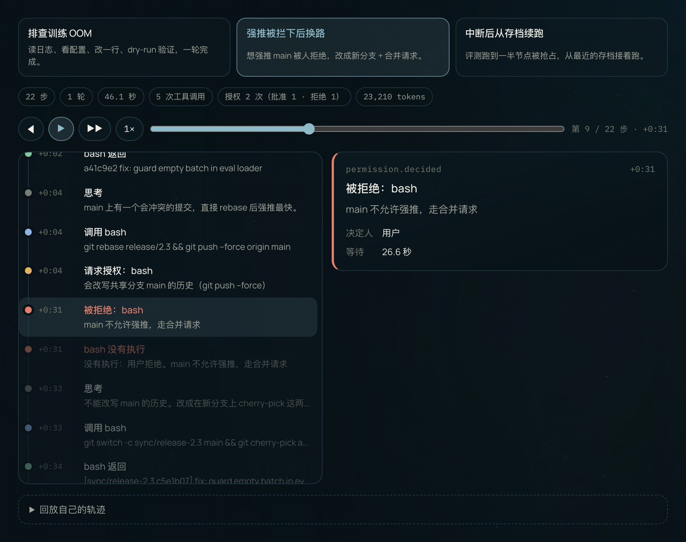
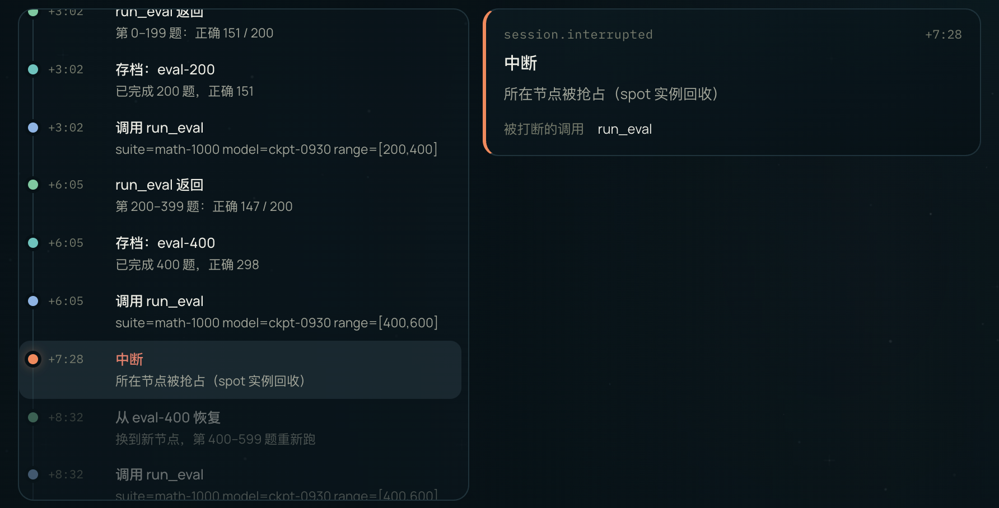

<div align="center">

# Agent Trace Replay

**Agent 运行轨迹回放器 · 它刚才到底做了什么？**

把一次 Agent 运行的思考、工具调用、授权和中断按时间线逐步回放：看清每一步做了什么、为什么停下、从哪接着跑。

[**在线使用**](https://ai-loren.github.io/personal-homepage/#projects/agent-trace-replay) · [轨迹格式](#轨迹格式) · [一个例子](#一个例子) · [API](#api) · [English](#english)

[](LICENSE)    



</div>

## 为什么需要它

一个 Agent 能不能放心交给它干活，取决于事后能不能看清它做了什么：想了什么，调了哪些工具，哪一步请人确认，被拒绝之后怎么办，断了之后从哪接着跑。

这些信息通常散落在一长串 JSON 日志里。调用、授权和结果分在不同的行，要靠肉眼对 id 才能拼起来。Agent Trace Replay 替你把它们串好，再按时间一步一步放给你看。

## 能做什么

- **逐步回放**：上一步、下一步、拖动进度条、点任意一步，也可以自动播放（1× / 2× / 4×）。键盘 ← → 走一步，空格播放或暂停。
- **把相关事件串起来**：工具调用、授权请求、授权决定和结果按 id 配对。看得出每次授权等了多久，哪一步因为被拒绝而没有执行，中断打断了哪个调用。
- **一眼看到全局**：步数、轮数、总时长、工具调用次数、失败次数、授权（批准 / 拒绝）、中断与存档次数、token 用量。
- **颜色区分状态**：时间线上的圆点区分思考、调用、等待授权、成功、被拒绝或失败、存档、中断、恢复；还没播到的步骤变淡。
- **回放自己的轨迹**：粘贴 JSONL 或打开本地文件。不认识的事件类型原样显示，不会被丢掉；格式有误时，告诉你是第几行、期望什么、怎么改。
- **零依赖**：一个 JS 文件，纯前端运行；解析和统计都是纯函数，可以单独调用。

## 三条内置轨迹

| 轨迹 | 规模 | 看点 |
| --- | --- | --- |
| 排查训练 OOM | 16 步，4 次工具调用 | 读失败日志 → 看配置 → 把 `recompute` 改成 `full` → dry-run 确认每卡 55.3 GiB 放得下 |
| 强推被拦下后换路 | 22 步，授权 2 次（批准 1，拒绝 1） | 第 9 步人拒绝了 `git push --force`（等了 26.6 秒），Agent 改成新分支 + cherry-pick + 合并请求 |
| 中断后从存档续跑 | 23 步，存档 4 次，中断 1 次 | 第 11 步节点被抢占，打断了一次 `run_eval`；从 `eval-400` 恢复，只重跑中断的那一段 |

## 一个例子



「中断后从存档续跑」在 1,000 道数学题上评测一个 checkpoint，每 200 题存一次进度：

1. 跑完第 0–199、200–399 题，分别存档 `eval-200`、`eval-400`。
2. 第 400–599 题跑到一半（+7:28），所在节点被抢占。时间线标出中断，并指出被打断的是那次 `run_eval`。
3. 一分钟后在新节点上从 `eval-400` 恢复，重新跑第 400–599 题，之前的进度都在。
4. 跑完剩下两段，汇总正确 754 题、准确率 75.4%。各段结果加起来正好是这个数，测试里也核对了。

右边是停在第 11 步「中断」时的样子：左边时间线里没播到的步骤是暗的，右边是这一步的全部字段。

<br clear="right">

## 轨迹格式

JSONL：每行一个 JSON 事件，必填 `t`（距开始的秒数，不能倒退）和 `type`，其余字段按 `type` 解释。

```jsonl
{"t": 0, "type": "turn.started", "turn": 1, "prompt": "把热修复同步到 main"}
{"t": 4.3, "type": "tool.call", "id": "call-2", "name": "bash", "input": {"command": "git push --force origin main"}}
{"t": 4.4, "type": "permission.requested", "toolCallId": "call-2", "risk": "high", "reason": "会改写 main 的历史"}
{"t": 31.0, "type": "permission.decided", "toolCallId": "call-2", "decision": "denied", "by": "user", "reason": "走合并请求"}
{"t": 31.2, "type": "tool.result", "toolCallId": "call-2", "ok": false, "output": "没有执行：用户拒绝"}
{"t": 46.1, "type": "turn.completed", "turn": 1, "usage": {"inputTokens": 21730, "outputTokens": 1480}}
```

| type | 字段 | 含义 |
| --- | --- | --- |
| `session.started` / `session.completed` | `task`、`agent`、`model` / `summary` | 整次运行的开始与结束 |
| `turn.started` / `turn.completed` / `turn.failed` | `turn`、`prompt` / `usage` / `error` | 每一轮的起止；`usage` 是 `{ inputTokens, outputTokens }` |
| `thinking` | `text` | 模型的思考 |
| `message` | `role`（`assistant` 或 `user`）、`text` | 回复或用户输入 |
| `tool.call` | `id`、`name`、`input` | 调用工具 |
| `tool.result` | `toolCallId`、`ok`、`output` | 调用结果，按 `toolCallId` 配对 |
| `permission.requested` | `toolCallId`、`risk`（`high` / `medium` / `low`）、`reason` | 请求人确认 |
| `permission.decided` | `toolCallId`、`decision`（`approved` / `denied`）、`by`（`user` / `policy`）、`reason` | 确认结果 |
| `checkpoint.saved` | `label`、`note` | 存档 |
| `session.interrupted` | `reason` | 被中断 |
| `session.resumed` | `from`、`note` | 从某个存档恢复 |

其他 `type` 原样显示，所有字段都保留。事件命名参照了 [Managed-Agent](https://ai-loren.github.io/personal-homepage/#projects/managed-agent) 的事件流（`turn.*`、`tool.*`、`permission.decided`）。

## 隐私与安全

- **不上传**：粘贴或打开的轨迹只在当前页面里解析和显示，不联网。
- **不执行**：每个字段都用 `textContent` 写进页面，不当 HTML 解析。轨迹里就算有 `<script>` 或 `onerror=`，也只会显示成文字，测试里专门验证过。
- **有上限**：单份轨迹最多 200 万个字符、5,000 个事件。超出时会提示截取一段再试。

## 快速开始

**在线**：打开 [ai-loren.github.io/personal-homepage/#projects/agent-trace-replay](https://ai-loren.github.io/personal-homepage/#projects/agent-trace-replay)，选一条示例，点「播放」。

**在自己的页面里用**：引入脚本后，工具注册在 `window.SITE_TOOLS['agent-trace-replay']` 上。

```html
<script src="agent-trace-replay.js"></script>
<script>
  const replay = window.SITE_TOOLS['agent-trace-replay'];
  const { events, error } = replay.parse(jsonlText);
  if (error) throw new Error(error); // 例如「第 3 行不是合法的 JSON：……」

  const stats = replay.summarize(events);
  console.log(stats.toolCalls, stats.permissions); // 5 { requested: 2, approved: 1, denied: 1 }

  for (const step of replay.timeline(events)) {
    console.log(replay.clock(step.t), step.status, step.title); // +0:31 denied 被拒绝：bash
  }
</script>
```

想要现成的界面，就调 `replay.mount(element)`。它会渲染完整的示例切换、统计、控制条、时间线和详情，结构上带 `trace-*` 类名，样式由你的页面提供。

## API

| 导出 | 说明 |
| --- | --- |
| `parse(text)` | 解析 JSONL，返回 `{ events }`；出错时只返回 `{ error }`，写明第几行、期望什么、怎么改 |
| `timeline(events)` | 每个事件对应一步：`{ index, t, type, status, title, text, fields, raw }`，调用、授权、结果已经按 id 串好 |
| `summarize(events)` | `{ duration, steps, turns, toolCalls, toolFailures, unfinished, permissions, checkpoints, interruptions, tokens }` |
| `clock(seconds, spoken?)` | `+1:15` 这样的时间偏移；`spoken` 为真时返回「26.6 秒」「2 分 5 秒」 |
| `mount(element)` | 在元素里渲染完整的回放界面 |
| `SAMPLES` | 三条内置轨迹：`{ id, title, summary, jsonl }` |

`status` 取值：`start`、`think`、`reply`、`user`、`call`、`ask`、`ok`、`denied`、`error`、`save`、`interrupt`、`resume`、`done`、`info`。

## 测试

```bash
node --test
```

需要 Node 18 以上，不用安装依赖。期望值都是对着内置轨迹逐条数出来的字面数字，覆盖这些内容：

- 三条内置轨迹的统计
- 授权的配对与等待时长
- 被拒绝的调用标成「没有执行」，之后 Agent 没有再试强推
- 中断指出被打断的调用，两次中断互不串
- 恢复点指向中断前存过的档
- 工具输入的简写
- 未知事件原样保留
- 像 HTML 的文字保持为文字
- 每一种格式错误的提示与行号

## 参考

- [Managed-Agent](https://ai-loren.github.io/personal-homepage/#projects/managed-agent)：云端 Agent 运行时与托管平台，本工具的事件命名参照了它的事件流。
- Yao et al. [ReAct: Synergizing Reasoning and Acting in Language Models](https://openreview.net/forum?id=WE_vluYUL-X). ICLR 2023. 「思考 → 行动 → 观察」交替的轨迹结构。
- [OpenTelemetry Semantic Conventions for Generative AI](https://github.com/open-telemetry/semantic-conventions-genai)：记录 Agent 调用与工具执行的 span 规范。

## English

Agent Trace Replay replays an AI agent run step by step from a JSONL trace, so you can see afterwards what it did: what it thought, which tools it called, which call a person approved or refused, where it was cut off and where it picked up again.

- **Linked events**: tool calls, permission requests, decisions and results are paired by id, showing how long a decision took, which call never ran because it was denied, and which call an interruption cut off.
- **Playback**: step, scrub, click any step or autoplay at 1×/2×/4×, with run-level stats (steps, turns, duration, tool calls, failures, approvals and denials, interruptions, checkpoints, tokens).
- **Your own traces**: paste JSONL or open a file. Unknown event types are kept as they are; parse errors name the line, what was expected and how to fix it.
- **Local and safe**: nothing is uploaded, and every value is written with `textContent`, never parsed as HTML.
- A single dependency-free JavaScript file. Try it [online](https://ai-loren.github.io/personal-homepage/#projects/agent-trace-replay), or use `parse`, `timeline` and `summarize` from `window.SITE_TOOLS['agent-trace-replay']`.

## License

[MIT](LICENSE)
